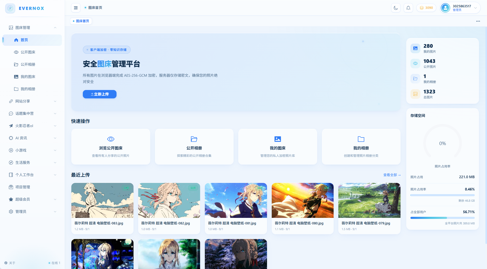

# EverNox Studio · 永夜照相馆

一个自托管的个人数字生活平台，把日常会用到的工具集中在一个站点里：图床相册、网站导航、记事本、记账、绩效与工资、话题社区、火影忍者OL 图鉴 / 测验 / 组织积分、项目版本发布、应援板、实用查询与 AI 工具。

所有数据都存在自己的服务器上（MySQL + 本地磁盘），不依赖任何云服务。



## 技术栈

| 层 | 技术 |
|---|---|
| 后端 | Spring Boot 3.2.5 · Java 21 · MyBatis-Plus 3.5.5 · MySQL 8 · Redis · JWT (jjwt) · Argon2id · jsoup · Hutool · Apache POI |
| 前端 | Vue 3 · TypeScript · Vite 5 · Element Plus · Pinia · Vue Router 4 · ECharts 6 · Quill 2 · axios |
| 部署 | 可执行 jar + Nginx 反向代理，文件存储在本机磁盘 |

## 功能模块

- **图床管理**：图片 / 相册，公开与私密可见性可切换，服务端加密落盘，自动生成缩略图，支持相册封面裁剪
- **网站分享**：友链导航、标签分类、管理员审批
- **火影忍者OL**：游戏公告、喵问答（带图题库，按文件夹导入，游戏内已排除的选项划线不可选）、忍者图鉴（离线数据集，含技能信息）、忍者测验（JSON 批量导入；答案留空的题目由用户投票确认，连续 3 人选择一致即写入答案并各得 10 积分）、组织积分（周积分、奖励礼包、Excel 导入）
- **项目版本发布**：每个项目独立的版本列表、发布说明、附件与公开下载地址，自动生成 `latest.yml`，可作为桌面启动器的更新镜像使用
- **个人工作台**：记事本（富文本 + 图片，可公开）、待办、记账、绩效（项目 / 加班 / 迟到）、工资
- **话题集中营**：圈子、帖子、评论、点赞、收藏
- **应援板**：多人协作像素画，Redis 缓存加速
- **实用查询**：地震信息、天气查询
- **AI 工具**：AI 编程资讯（Hacker News，自动翻译）、Code Arena 模型排行榜（12 个分类 + 价格筛选）、Ollama 模型库
- **账号体系**：注册 / 登录 / JWT 无状态鉴权 / 邮箱找回密码（SMTP）/ 积分与会员（每日签到、积分升级、卡密兑换）
- **管理员后台**：用户、资产、网站审批、笔记审批、公告、话题、测验、积分与会员、卡密、访问数据、应援板

## 运行环境

| 软件 | 版本要求 | 说明 |
|---|---|---|
| JDK | 21 | 后端编译与运行 |
| Maven | 3.8+ | 后端打包 |
| Node.js | 18+（含 npm） | 前端开发与打包 |
| MySQL | 8.0 | 主数据库，库名会自动创建 |
| Redis | 任意 5.0+ | 仅用于应援板像素缓存；未启动时自动回退数据库，不装也能运行 |
| Nginx | 1.20+ | 生产环境托管前端静态文件并反向代理后端接口 |

## 部署步骤

### 1. 获取代码

```bash
git clone https://github.com/kirito10010/evernox-studio.git
cd evernox-studio
```

### 2. 配置后端

后端启动时会读取工作目录下的 `config/application.yml`（优先级高于 jar 内配置，不会被打包）。在 `evernox-backend/config/` 下新建该文件：

```yaml
spring:
  datasource:
    username: root
    password: <数据库口令>
  mail:                                  # 可选：邮箱找回密码功能需要
    username: <SMTP 账号>
    password: <SMTP 授权码>

evernox:
  security:
    allowed-origins:
      - http://localhost:5211            # 前端访问地址，线上改成自己的域名
  codec:
    secret: "<图片编解码密钥>"
    salt: "<图片编解码盐，必须是合法 Base64>"
  admin:
    username: "<管理员账号>"
    password: "<管理员初始密码>"
    email: "<管理员邮箱>"
```

- 数据库不存在时会自动创建，表结构由 `src/main/resources/schema.sql` 在启动时初始化。
- `evernox.codec.secret` / `salt` 用于图片加密落盘，**一旦存入图片就不可再修改**，请妥善保存。
- Redis 默认连接 `localhost:6379`，地址不同时在 `spring.data.redis` 下覆盖。

### 3. 打包

```bash
# 后端 → evernox-backend/target/evernox-backend-1.0.0.jar
cd evernox-backend
mvn clean package -DskipTests

# 前端 → evernox-frontend/dist/
cd ../evernox-frontend
npm install
npm run build
```

> 如果用 IDE 打开后端并依赖它的编译输出（`target/classes`），打包时可加 `-Dbuild.dir=target-package` 输出到独立目录，避免 `clean` 删掉 IDE 的编译缓存；产物路径相应变为 `target-package/`。

### 4. 配置 Nginx

```nginx
server {
    listen 80;
    server_name your-domain.com;

    root /path/to/evernox-frontend/dist;
    index index.html;

    # 版本发布为 4MB 分片上传、喵问答为整文件夹导入，Nginx 默认 1MB 会返回 413
    client_max_body_size 64m;

    location / {
        try_files $uri $uri/ /index.html;
    }

    location /api/ {
        proxy_pass http://127.0.0.1:11002/api/;
        proxy_set_header Host $host;
        proxy_set_header X-Real-IP $remote_addr;
        proxy_set_header X-Forwarded-For $proxy_add_x_forwarded_for;
        proxy_set_header X-Forwarded-Proto $scheme;
        proxy_read_timeout 300s;
    }

    # 启动器更新镜像：不要 gzip，也不要重写到 index.html
    # （下载依赖 Range / Content-Length 实现断点续传）
    location /api/release/public/ {
        proxy_pass http://127.0.0.1:11002/api/release/public/;
        gzip off;
    }
}
```

### 5. 启动后端

```bash
cd evernox-backend
java -Xms256m -Xmx512m -jar target/evernox-backend-1.0.0.jar
```

后端默认监听 `11002`，接口统一带 `/api` 前缀（与上面的 `proxy_pass` 保持一致）。启动后访问 Nginx 配置的地址即可，首次登录使用 `evernox.admin` 里的管理员账号。

### 本地开发

Windows 下可直接双击 `start.bat`（会清理端口占用并先后启动前后端），也可以手动运行：

```bash
cd evernox-backend && mvn spring-boot:run     # 后端 :11002
cd evernox-frontend && npm run dev            # 前端 :5211（/api 已代理到 11002）
```

访问 `http://localhost:5211`。

## 交流与反馈

- 开发者：**lijin**
- 邮箱：a3025863517@163.com
- 官方 QQ 群：**489455643** · [点击加入](https://qm.qq.com/q/RAGf04Vq6G)


